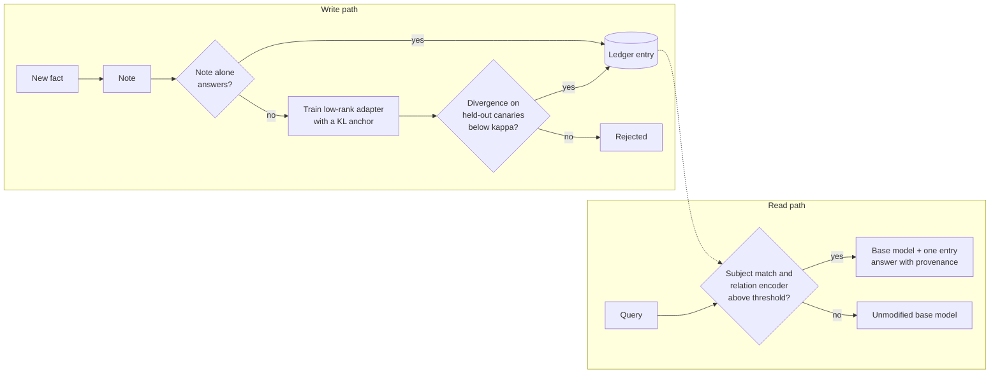

# RELIC

[](https://github.com/kaelvalen/relic/actions/workflows/ci.yml)
[](LICENSE)


**R**evocable **E**ntries for **L**anguage model **I**nsertions and **C**orrections:
transactional knowledge updates for frozen language models.

The name describes the design. Each fact learned after deployment is an *entry* of its
own. An entry is an *insertion* of a fact the *language model* does not know or a
*correction* of an answer it gives, and the model itself is never changed. Every entry is
*revocable*: removing a fact deletes its entry and nothing else, so the model answers
exactly as it did before the fact was added.

RELIC keeps a pre-trained language model frozen and stores each fact learned after
deployment as a separate entry: a note (the fact's statement, served in the system prompt
with an instruction to follow it) and, if the note alone does not produce the answer, a
small low-rank adapter. A router applies at most one entry to a query and otherwise
answers with the unmodified base model. Every answer reports which entry produced it.

## How it works



- The base model never changes. Each entry is independent, so a fact can be added,
  suspended or deleted without touching the others, and a deletion is exact.
- Adapters are low-rank updates of `q_proj` and `v_proj` in all layers. The tables below
  use rank 16 (8.7 MB per fact). `Ledger.write` trains rank 2 with LoRA+ in int8 (373 KB), which
  matches rank 16 on serving and keeps fewer answers on a wrong route (entry 114).
- The router has no parameters trained on the store. It matches the stored subject and
  compares the query's relation with the stored relation using a relation encoder
  (all-mpnet-base-v2 trained offline on relation triplets, then frozen).
- Every experiment is recorded with its predictions before it is run; see
  [Pre-registration](#pre-registration).

## Results

Qwen2.5-1.5B-Instruct, 1000 facts per dataset, every query served through the router,
adapter and note served together unless stated. Source:
[`docs/LIVING_MODEL_CONFIRMATORY_PREREG.md`](docs/LIVING_MODEL_CONFIRMATORY_PREREG.md),
entries 64 to 139.

| Reading | CounterFact, router v4 (MiniLM) | CounterFact, default router | zsRE, default router |
| :-- | :-- | :-- | :-- |
| Edit prompts answered | 0.996 | 0.996 | 0.989 |
| Paraphrases answered | 0.803 | 0.891 | 0.982 |
| Paraphrases answered, adapter only | 0.669 | 0.730 | 0.967 |
| Other relation of a stored subject: output contains a stored answer | 0.237 | 0.043 | not measured |
| Same relation, other subject (neighborhood): leakage | 0.016 | 0.017 | not measured |
| Synthetic-name distractors and NQ questions routed | 0 | 0 | 0 |
| Removed facts returning to the base answer (100 removed) | 1.00 | 1.00 | 0.84 (1.00 with write-time slots) |
| Facts that need an adapter (tiered store) | 0.162 | 0.162 | 0.206 |

These stores were built with the earlier rank-16 adapters (8.7 MB each). Entry 94
rebuilt both with the adopted 373 KB adapter (0.75 GB instead of 17.4 GB for the two
stores) and repeated the evaluation. Every serving reading moved by less than 0.01 and
leakage and removal were unchanged, but an adapter on a wrong route keeps fewer of the base
model's correct answers. Entry 100 repeated that reading on 1000 questions: 0.668 against
0.705, a paired difference of -0.037 with lower end -0.058, against a margin of -0.03. The
table therefore keeps the rank-16 stores as the main build.

### Further checks

| Question | Entry | Outcome |
| :-- | :-- | :-- |
| Does the relation encoder only memorise the phrasings it was trained on? | 79, 82 | No. Paraphrase routing is 0.988 on seen phrasings, 0.960 on unseen phrasings and 0.838 on relations never trained on (frozen encoder: 0.648, 0.634, 0.543). Outside the calibrated phrasings its threshold routes 7.5% to 11% of other-relation queries instead of 5%. |
| Do natural questions written by another model leak? | 85, 88, 91 | Questions by SmolLM3-3B about an unrelated attribute of a stored subject are routed 0.2% of the time. Questions about a closely related attribute are routed 31% of the time; after labelling, 11.7% of them get a wrong stored answer (5.9% over all natural questions). |
| Can the adapter be smaller? | 81 to 89 | Yes. Rank 2 with LoRA+ in int8 (373 KB) matches the rank-16 adapter (8.7 MB) on 279 fresh adapter facts: paraphrase with note 0.928 against 0.918, 2.9% against 2.2% of adapters above the divergence limit. |
| Is representation finetuning (LoReFT, DiReFT) a better per-fact adapter? | 92, 93 | No. At 172 KB LoReFT reaches the same paraphrase rate, but 82% to 100% of the interventions exceed the divergence limit on held-out prompts. |
| Does a store change standard benchmarks? | 101, 116 | Not as served: 0 of 500 MMLU and 500 ARC questions are routed, so accuracy equals the base model's (0.665). Forcing a random entry costs 2.2 points. |
| Do repeated writes of one fact survive a removal? | 96, 104, 115, 122 | Not any more. A same-answer write joins the entry wherever a query would be routed to it, and a different answer needs a stricter threshold before it replaces one. zsRE return rises from 0.84 to 1.00 at 206 merges, and on fresh facts residual routes fall from 0.99 to 0.01, with no merge of different answers. |
| Are aliases and pronouns handled? | 105, 119 | On constructed conversations. Wikidata aliases cover about 40% of subjects; alias paraphrases route 0.865 and 0.961, pronouns on edit prompts 0.998 and 1.000, with no new false routes. |
| Does the threshold depend on the relation? | 107, 109, 138, 139 | Yes. A threshold per relation lowers routing of neighboring-relation questions from 30.5% to 16.9%, at 0.3 to 0.7 points of paraphrase routing, where a relation identifier exists. On 400 fresh facts as served, the automatic leak on those questions falls from 0.296 to 0.171 at 0.25 points of paraphrase. `Ledger` takes these as `relation_tau`. |
| Does the answer score flatter the results? | 97, 99 | Not for adapter and note (at most 0.3 points at a word boundary). It does for the note alone on zsRE: 0.794 by substring, 0.741 at a word boundary. |
| Do mined hard negatives help the router? | 110, 123 | No. Neither arm is adopted: mining moves leakage from natural questions to template prompts. Training on every relation raises routing of neighboring-relation questions from 30% to 52%. |
| Can one adapter hold a shard of facts and still remove exactly? | 112, 124 | Not yet. On 96 facts no arm of 8 to 32 facts passes: paraphrase with note stays 5 to 21 points below per-fact adapters. Retraining takes about 4.6 s per fact and repeated bitwise in one process. Eight facts at rank 2 store 47 KB per fact and leak less, so this stays open. |
| Can a soft prompt replace the adapter? | 113, 128 | No. Ten trained tokens per fact (31 KB) reach 0.57 on edit prompts and 0.33 on paraphrases alone, against 0.99 and 0.82 for rank 2. |
| Does the adapter alone beat the note alone? | 125, 127 | Yes, in all four cells at rank 2: +16.1 and +25.9 points on edit prompts, +4.9 and +19.7 on paraphrases. Adding the note still gives 15 points on CounterFact paraphrases. |
| Can rewrites make the note unnecessary? | 126, 129 | Not yet. CounterFact paraphrases alone rise from 0.73 to 0.95, level with the note, but the forced leak on the subject's other relation rises from 0.36 to 0.63 and answers kept under a wrong route fall from 0.66 to 0.55. No arm passes. |
| And through the router and the gate? | 130, 131 | Not yet. The leak stays level with the current store (E3 0.020 against 0.020, natural 0.114 against 0.107), but CounterFact paraphrases reach 0.880 against 0.913, because the gate rejects 19 of 300 adapters. With the gate off they reach 0.920. |
| With a retry for rejected adapters, on fresh facts? | 136, 137 | No. On 800 fresh facts the retry removes the gate's cost, and CounterFact paraphrases reach 0.895 against 0.915 for the current store, lower bound -0.045 against a margin of -0.03. Edit prompts reach 0.986 against 0.965, and the leak does not separate the stores. The note stays. |

### Other base models

Same 2000 facts, word-boundary score (entries 98, 120). A fact needs an adapter if its note does
not answer its edit prompt.

| Model | Facts that need an adapter, pooled (95% CI) | Tiered store, edit prompts (CounterFact, zsRE) |
| :-- | :-- | :-- |
| Qwen2.5-0.5B | 0.034 (0.026 to 0.042) | 0.998, 0.999 |
| Qwen2.5-1.5B | 0.212 (0.194 to 0.229) | 0.997, 0.996 |
| Qwen2.5-1.5B, 4-bit | 0.218 (0.200 to 0.235) | 0.996, 0.992 |
| Qwen2.5-3B, 4-bit | 0.110 (0.096 to 0.124) | 0.998, 0.987 |
| Qwen2.5-7B, 4-bit | 0.088 (0.076 to 0.101) | 0.993, 0.989 |
| SmolLM3-3B, 4-bit | 0.050 (0.040 to 0.060) | 0.986, 0.983 |

The registered outcome at 7B is that the need depends on the model and the adapter stays an
optional tier. Size does not explain it: the smallest model needs the fewest adapters. The divergence
limits were set on 1.5B and most adapters at 3B and 7B exceed them, so their protection on those models
is unmeasured.

## Comparison with editing methods

The architecture is not new. SoLA ([arXiv 2603.11239](https://arxiv.org/abs/2603.11239)) stores each edit as a frozen
LoRA behind semantic routing and revokes it by removing its key, and RRDA
([arXiv 2606.14668](https://arxiv.org/abs/2606.14668)) combines a router, an explicit edit memory and adapters. Both
predate this repository. What RELIC adds is measurement: the cost of a wrong route to one fact, the share of facts that
need an adapter across base models, removal under repeated writes, and rejection by divergence on held-out prompts, each
registered before it was run. We did not find these readings elsewhere, in a search that was not systematic.

GRACE and WISE were run with their official code on 200 CounterFact facts, against 1000 for
RELIC, so this comparison is descriptive and not a ranking. It is also sensitive to format:
GRACE answers all 200 on the plain edit prompt and 2.5% under the chat template, because its
keys are activations of the last token of the plain prompt. WISE answers 100% one at a time
and 7% after all 200 sequential edits. Neither provides an operation for removing one edit.
See entries 53, 54 and 63 of the pre-registration and the paper.

## Limitations

- Near-neighbour relations (country of origin against location of formation, original
  language against language of the work) are the main remaining source of leakage; the
  boundary has to be learned from examples of that pair. On 400 fresh CounterFact facts the automatic
  count is 0.296 of such questions with one threshold and 0.171 with thresholds per relation (entry 139).
- A wrong route is costly. Served as the system serves it, with adapter and note, an
  unrelated fact keeps 40% of the base model's correct answers; the note alone keeps 51%
  and the adapter alone 71% (entry 100, 1000 questions). The router's false-route rate is
  what keeps this cost small.
- The natural-question labels were assigned by the language model used in the analysis,
  blind to the router, not by a human annotator.
- Multi-fact questions are not tested. Qwen sizes up to 7B and one other family were tested on
  answer rates only; leakage, removal and the wrong-route cost were measured on 1.5B.
- The divergence limit is calibrated on 1.5B. On another base model, measure it first and pass it as
  `Ledger.write(fact, kappa=...)`.
- "Transactional" covers one process: commits from threads are serial and saving is atomic. Two
  processes writing one store are not coordinated.
- Pronoun handling was tested by substitution on constructed conversations. The rewrite reads the
  store, so removing a fact can change the subject a pronoun on a later turn is rewritten to.
- Known defect, not fixed yet: the state hash covers the model's name and not its revision.

## Repository layout

```text
relic/
├── relic/                          # the system: ledger, router, serving, model wrapper, readings
├── experiments/sandbox/live_learning/
│   ├── text/                       # exploratory records: controller, sessions, checks
│   ├── confirm/                    # confirmatory runs: data adapters, pilot, evaluations
│   ├── vlm/                        # vision-language runs (Qwen3-VL-2B)
│   └── STATE.md                    # current state and next steps
├── docs/                           # positioning, pre-registration records, review notes
├── paper/                          # LaTeX source, tables, figures, numbers generator
└── tests/
```

## Pre-registration

Every experiment was registered in
[`docs/LIVING_MODEL_SLICE_PREREG.md`](docs/LIVING_MODEL_SLICE_PREREG.md) (exploratory
phase) or
[`docs/LIVING_MODEL_CONFIRMATORY_PREREG.md`](docs/LIVING_MODEL_CONFIRMATORY_PREREG.md)
(confirmatory phase) before it was run, with its predictions and decision rule. Failed
predictions are reported as failed, and deviations are written down with their reason.
Pinned entries are tagged in git (`prereg-ss*`). Result files are written to
`results/`, which is not tracked.

## Using the store

```python
from relic.ledger import DeltaStore, Ledger
from relic.router import RELATION_TAU, make_scorer

store = DeltaStore("Qwen/Qwen2.5-1.5B-Instruct", steps=16, capacity=1)
# the relation encoder comes from confirm/train_relation_encoder.py
ledger = Ledger(store, make_scorer("relenc"), 0.7501, 0.8985, relation_tau=RELATION_TAU)

ledger.write({
    "id": "f1",
    "subject": "Danielle Darrieux",
    "probe": "The mother tongue of Danielle Darrieux is",
    "paraphrase": "Danielle Darrieux spoke the language",
    "answer": "English",
    "teach": "The mother tongue of Danielle Darrieux is English",
    "aliases": ["Danielle Yvonne Darrieux"],
    "relation": "P103",  # optional: lets a stricter threshold apply
})
ledger.ask("What is her mother tongue?", history=["Tell me about Danielle Darrieux."])
ledger.revoke("f1")  # back to the base model's answer
```

`experiments/sandbox/live_learning/confirm/ledger_smoke.py` runs this end to end on the real model.

## Running

```bash
uv sync                                 # full local environment: dev, quant, experiments
uv sync --no-default-groups             # the library only (or: pip install -e .)
python -m pytest                        # test suite

# end-to-end evaluation of a saved store with the default router (requires the saved
# checkpoint); the locality and threshold analyses read its output
.venv/bin/python experiments/sandbox/live_learning/confirm/train_relation_encoder.py
.venv/bin/python experiments/sandbox/live_learning/confirm/router_v7_select.py --scorers relenc \
  --out results/live_learning/confirm/router_v8_select.json --prereg SS76
.venv/bin/python experiments/sandbox/live_learning/confirm/v7_eval.py --dataset counterfact \
  --selection results/live_learning/confirm/router_v8_select.json --suffix v8 --prereg SS76
.venv/bin/python paper/make_numbers.py   # regenerate paper/numbers.tex

# build the paper (paper/main.tex)
cd paper && mkdir -p build && nix run nixpkgs#tectonic -- main.tex -o build
```

Environment notes for the GPU runs (NixOS, shared 8 GB GPU) are in
[`experiments/sandbox/live_learning/README.md`](experiments/sandbox/live_learning/README.md).

## Earlier work

The project started as PAL-MoE, a mixture-of-experts model for class-incremental
learning, followed by a closed-form vision study. Neither is part of this package. Their
documents and runners are in the history at `894ad16^`, and their library code is at the
tag `archive/pre-llm-library`.

## Citation

```bibtex
@software{relic2026,
  author = {Hakbilen, Mehmet Arda},
  title  = {RELIC: Transactional Knowledge Updates for Frozen Language Models},
  url    = {https://github.com/kaelvalen/relic},
  year   = {2026}
}
```

## License

MIT, see [LICENSE](LICENSE).
