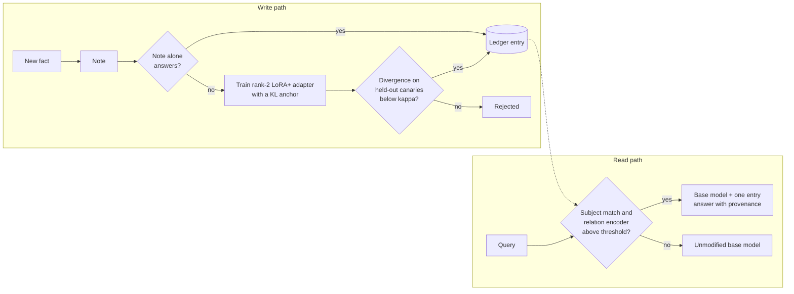

# RELIC

[](https://github.com/kaelvalen/relic/actions/workflows/ci.yml)
[](LICENSE)


Transactional knowledge updates for frozen language models. RELIC stands for Revocable
Entries for Language model Insertions and Corrections.

RELIC keeps a pre-trained language model frozen and stores each fact learned after
deployment as a separate entry: a note (the fact's statement, served in the system prompt
with an instruction to follow it) and, if the note alone does not produce the answer, a
small low-rank adapter. A router applies at most one entry to a query and otherwise
answers with the unmodified base model. Removing a fact deletes its entry, and every
answer reports which entry produced it.

## How it works



- The base model never changes. Each entry is independent, so a fact can be added,
  suspended or deleted without touching the others, and a deletion is exact.
- Adapters are rank 2 on `q_proj` and `v_proj` in all layers, trained with LoRA+ and
  stored in int8: 373 KB per fact.
- The router has no parameters trained on the store. It matches the stored subject and
  compares the query's relation with the stored relation using a relation encoder
  (all-mpnet-base-v2 trained offline on relation triplets, then frozen).
- Every experiment is recorded with its predictions before it is run; see
  [Pre-registration](#pre-registration).

## Results

Qwen2.5-1.5B-Instruct, 1000 facts per dataset, every query served through the router,
adapter and note served together unless stated. Source:
[`docs/LIVING_MODEL_CONFIRMATORY_PREREG.md`](docs/LIVING_MODEL_CONFIRMATORY_PREREG.md),
entries 64 to 93.

| Reading | CounterFact, router v4 (MiniLM) | CounterFact, default router | zsRE, default router |
| :-- | :-- | :-- | :-- |
| Edit prompts answered | 0.996 | 0.996 | 0.989 |
| Paraphrases answered | 0.803 | 0.891 | 0.982 |
| Paraphrases answered, adapter only | 0.669 | 0.730 | 0.967 |
| Other relation of a stored subject: output contains a stored answer | 0.237 | 0.043 | not measured |
| Same relation, other subject (neighborhood): leakage | 0.016 | 0.017 | not measured |
| Synthetic-name distractors and NQ questions routed | 0 | 0 | 0 |
| Removed facts returning to the base answer (100 removed) | 1.00 | 1.00 | 0.84 (1.00 removing by content) |
| Facts that need an adapter (tiered store) | 0.162 | 0.162 | 0.206 |

These stores were built with the earlier rank-16 adapters (8.7 MB each). Entry 94
rebuilt both with the adopted 373 KB adapter (0.75 GB instead of 17.4 GB for the two
stores) and repeated the evaluation. Every serving reading moved by less than 0.01 and
leakage and removal were unchanged, but a wrong route kept 0.675 of the base model's
correct answers instead of 0.72, below the pre-registered limit of 0.69. As registered,
the table keeps the rank-16 stores as the main build; see entry 95.

### Comparison with existing methods

Share of edit prompts answered with the stored fact, in chat format.

| Method | Edit prompts answered |
| :-- | :-- |
| Note only (retrieval in the system prompt), 1000 facts | 0.84 |
| GRACE (official code, 200 facts) | 0.025 in chat format, 1.00 in plain text |
| WISE (official code, 200 facts) | 0.07 after 200 sequential edits, 1.00 one at a time |
| RELIC, 1000 facts | 0.996 |

One shared adapter for many facts holds 256 facts, but leaks 10% to 30% and cannot
remove a single fact.

### Further checks

| Question | Entry | Outcome |
| :-- | :-- | :-- |
| Does the relation encoder only memorise the phrasings it was trained on? | 79, 82 | No. Paraphrase routing is 0.988 on seen phrasings, 0.960 on unseen phrasings and 0.838 on relations never trained on (frozen encoder: 0.648, 0.634, 0.543). Outside the calibrated phrasings its threshold routes 7.5% to 11% of other-relation queries instead of 5%. |
| Do natural questions written by another model leak? | 85, 88, 91 | Questions by SmolLM3-3B about an unrelated attribute of a stored subject are routed 0.2% of the time. Questions about a closely related attribute are routed 31% of the time; after labelling, 11.7% of them get a wrong stored answer (5.9% over all natural questions). |
| Can the adapter be smaller? | 81 to 89 | Yes. Rank 2 with LoRA+ in int8 (373 KB) matches the rank-16 adapter (8.7 MB) on 279 fresh adapter facts: paraphrase with note 0.928 against 0.918, 2.9% against 2.2% of adapters above the divergence limit. |
| Is representation finetuning (LoReFT, DiReFT) a better per-fact adapter? | 92, 93 | No. At 172 KB LoReFT reaches the same paraphrase rate, but 82% to 100% of the interventions exceed the divergence limit on held-out prompts. |

## Limitations

- Near-neighbour relations (country of origin against location of formation, original
  language against language of the work) are the main remaining source of leakage; the
  boundary has to be learned from examples of that pair.
- A wrong route is costly: an adapter applied to an unrelated question keeps 72% of the
  base model's correct answers.
- The natural-question labels were assigned by the language model used in the analysis,
  blind to the router, not by a human annotator.
- One base model, one 8 GB GPU, single-entity answers. A second base model and
  multi-fact questions are not yet tested.

## Repository layout

```text
relic/
├── relic/                          # library code from the earlier programs (API, routers, edits, eval)
├── experiments/sandbox/live_learning/
│   ├── text/                       # store, ledger, router, controller, sessions
│   ├── confirm/                    # confirmatory harness: data adapters, pilot, evaluations
│   ├── vlm/                        # vision-language runs (Qwen3-VL-2B)
│   └── STATE.md                    # current state and next steps
├── docs/                           # positioning, pre-registration records, review notes
├── paper/                          # LaTeX source, tables, figures, numbers generator
└── tests/
```

## Pre-registration

Every experiment was registered in
[`docs/LIVING_MODEL_SLICE_PREREG.md`](docs/LIVING_MODEL_SLICE_PREREG.md) (exploratory
phase) or
[`docs/LIVING_MODEL_CONFIRMATORY_PREREG.md`](docs/LIVING_MODEL_CONFIRMATORY_PREREG.md)
(confirmatory phase) before it was run, with its predictions and decision rule. Failed
predictions are reported as failed, and deviations are written down with their reason.
Pinned entries are tagged in git (`prereg-ss*`). Result files are written to
`results/`, which is not tracked.

## Running

```bash
uv sync --extra dev --extra lm          # or: pip install -e ".[dev,lm]"
python -m pytest                        # test suite

# end-to-end evaluation of a saved store with the default router (requires the saved
# checkpoint); the locality and threshold analyses read its output
.venv/bin/python experiments/sandbox/live_learning/confirm/train_relation_encoder.py
.venv/bin/python experiments/sandbox/live_learning/confirm/router_v7_select.py --scorers relenc \
  --out results/live_learning/confirm/router_v8_select.json --prereg SS76
.venv/bin/python experiments/sandbox/live_learning/confirm/v7_eval.py --dataset counterfact \
  --selection results/live_learning/confirm/router_v8_select.json --suffix v8 --prereg SS76
.venv/bin/python paper/make_numbers.py   # regenerate paper/numbers.tex

# build the paper (paper/main.tex)
cd paper && mkdir -p build && nix run nixpkgs#tectonic -- main.tex -o build
```

Environment notes for the GPU runs (NixOS, shared 8 GB GPU) are in
[`experiments/sandbox/live_learning/README.md`](experiments/sandbox/live_learning/README.md).

## Earlier work

The project started as PAL-MoE, a mixture-of-experts model for class-incremental
learning, followed by a closed-form vision study (RELIC v3). That material was removed
from the working tree in commit `894ad16`; it is available in the history at
`894ad16^` (for example `git show 894ad16^:archive/docs/README.md`). The `relic/`
package still contains the library code from those programs, and `import pal_moe` is no
longer supported.

## Citation

```bibtex
@software{relic2026,
  author = {Hakbilen, Mehmet Arda},
  title  = {RELIC: Transactional Knowledge Updates for Frozen Language Models},
  url    = {https://github.com/kaelvalen/relic},
  year   = {2026}
}
```

## License

MIT, see [LICENSE](LICENSE).
